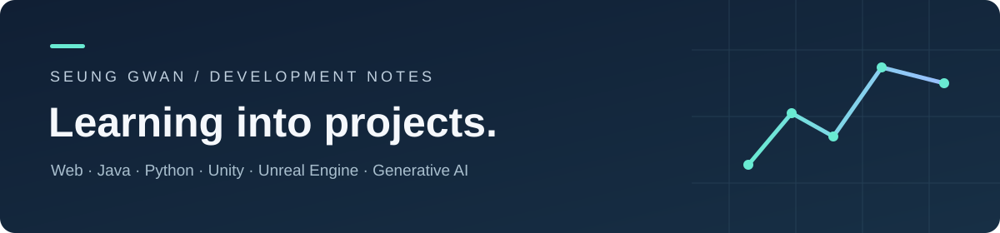

# 유승관의 개발 학습 · 프로젝트 기록

**배운 내용을 코드로 옮기고, 결과와 다음 과제를 기록합니다.**

웹, Java, Python, Unity, Unreal Engine과 생성형 AI를 공부하며 남긴 작업을 모았습니다.
프로젝트에서는 화면과 기능을, 학습 기록에서는 사용한 개념과 실습 코드를 확인할 수 있습니다.

[GitHub 프로필](https://github.com/seung-gwan) · [프로젝트](#프로젝트) · [학습 기록](learning/README.md) · [공개 자료의 범위](SOURCES.md)

## 프로젝트

### 01. Smart Farm

작물을 선택하고 온실 환경과 장치 상태를 살펴보는 웹/PWA 프로토타입입니다.
온도·습도·토양수분·CO₂ 등의 표시, 장치 조작, 외부 기후를 고려한 자동 제어를 시뮬레이션합니다.

`HTML` `CSS` `JavaScript` `PWA`

**[화면 체험](https://seung-gwan.github.io/smart-farm/)** · [소스 코드](https://github.com/seung-gwan/smart-farm) · [프로젝트 설명](projects/smart-farm.md)

### 02. 중고차 웹 프로젝트

회원정보, 차량 판매·구매, 공지사항과 후기 기능을 다루는 JSP/Servlet MVC 학습 프로젝트입니다.
요청을 처리하는 Controller와 Command, DB에 접근하는 DAO, 화면에 데이터를 전달하는 DTO 구조를 살펴볼 수 있습니다.

`Java` `JSP` `Servlet` `MySQL` `Maven`

[소스 코드](https://github.com/seung-gwan/web_) · [프로젝트 설명과 실행 방법](projects/jsp-car-market.md)

### 03. 손오공 — Unity 2D 액션 팀 프로젝트

떨어지는 물체를 공격·방어·회피하며 점수를 얻는 PC용 미니게임입니다.
이동·점프부터 낙하물 판정, 경고 UI, 체력·점수와 게임오버까지 이어지는 흐름을 구현했습니다.

**공동 기획 / 게임 구현 전반: 유승관 / 이미지 디자인: 이승훈**

`Unity` `C#` `2D Physics` `UI`

[시연 영상](https://github.com/seung-gwan/game-dev-studies/releases/download/showcase-2026-06/unity-final-gameplay.mp4) · [제작 과정과 기여](projects/unity-son-ogong.md) · [소스 코드](https://github.com/seung-gwan/game-dev-studies/tree/main/unity/project_New)


### 04. Unreal Engine — 환경 제작과 아포칼립스 구상

실내 조명, 지형·건물 배치에서 시작해 마을·도시 장면으로 이어지는 제작 과정입니다.
3월부터 6월까지의 작업 화면, 과제 영상과 기획 자료를 날짜 근거와 함께 정리했습니다.

`Unreal Engine 5.0` `Level Design` `Lighting` `Blueprint`

[날짜별 제작 과정](https://github.com/seung-gwan/game-dev-studies/blob/main/docs/unreal-timeline.md) · [프로젝트 소개](projects/unreal-environment.md) · [맵 자료](https://github.com/seung-gwan/game-dev-studies/tree/main/unreal)


## 학습 기록

| 분야 | 공부한 개념 | 결과물 · 기록 |
| --- | --- | --- |
| Java | 생성자, 캡슐화, 컬렉션, 이벤트 처리 | [계좌 모델 · Swing 전화번호부](learning/java.md) |
| Python | 조건·반복, 문자열, 재귀, 이진 탐색 트리 | [문자 변환 · 트리 경로 탐색](learning/python.md) |
| Unity · C# | 입력·물리, 공격·방어, UI, 장면 전환 | [손오공 팀 프로젝트와 6개 학습 프로젝트](learning/unity.md) |
| Unreal Engine | 조명, 지형·환경 배치, 맵과 블루프린트 | [날짜별 환경 제작 기록](learning/unreal-engine.md) |
| 생성형 AI | Dataset, U-Net, 조건부 DDPM, 학습 로그 | [이모지 생성 실습](learning/generative-ai.md) |
| 웹 기초 | HTML 태그, CSS 선택자·레이아웃, JavaScript 함수 | [웹 기초 예제](learning/web-basics.md) |

## 기록 방식

각 기록은 **공부한 내용 → 코드나 결과물 → 현재 범위 → 다음 개선점** 순서로 정리합니다.
학교 수업을 바탕으로 한 작업은 학습 실습으로 표시하고, 코드 확인과 실행 확인의 범위를 구분합니다.

새 작업을 추가할 때는 [프로젝트 기록 양식](templates/project-note.md)을 사용합니다.

## 저장소 구성

```text
projects/       기존 웹 프로젝트 설명과 소스 링크
learning/       분야별 학습 내용과 결과
examples/       학교 실습에서 선별한 Java·Python·Unity 코드
evidence/       AI 학습 로그 일부와 검증 기록
templates/      다음 프로젝트를 기록하는 양식
```

자료 기준: 기존 공개 GitHub 저장소와 학교 실습 파일. 상세한 출처와 선별 기준은 [SOURCES.md](SOURCES.md)에 정리했습니다.
